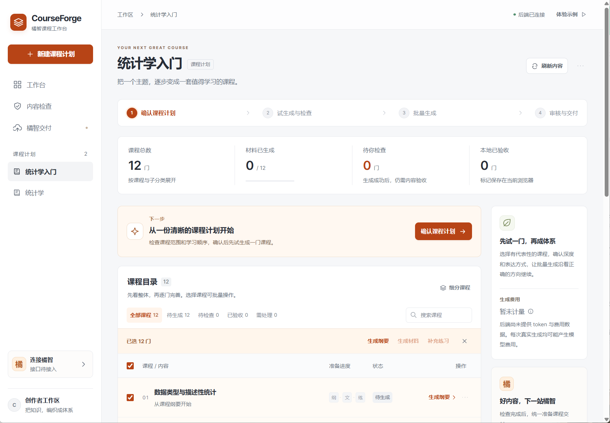
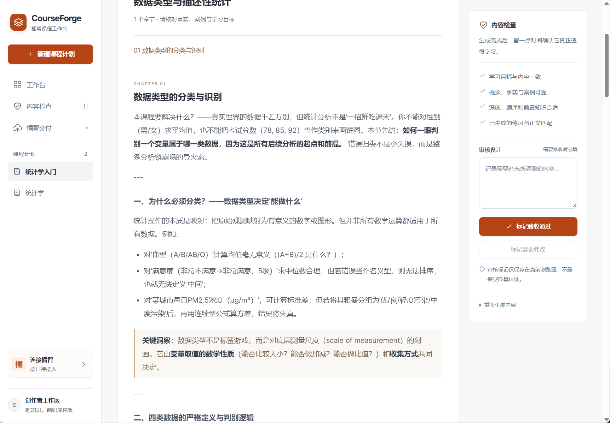
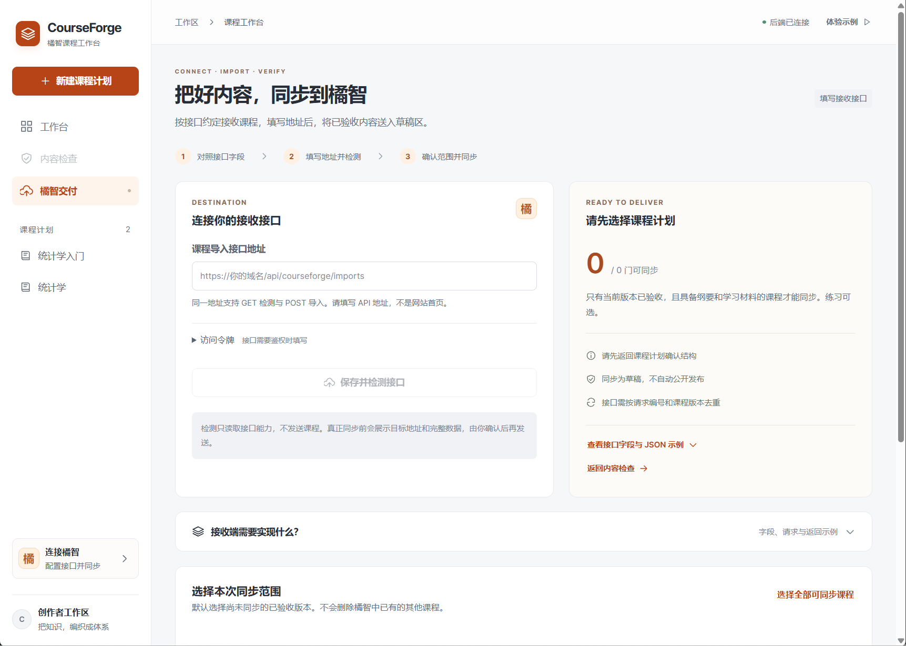

# CourseForge Frontend

[Frontend repository](https://github.com/Noahwakuwaku/courseforge-frontend) · [Backend repository](https://github.com/Noahwakuwaku/courseforge-api)

[简体中文](README.zh-CN.md) | English

CourseForge is a guided course-production workspace originally built to prepare systematic learning content for the creator platform JuZhi (橘智). It connects curriculum planning, sample review, batch generation and human acceptance in one interface.

This repository contains the Vue frontend. It requires the companion FastAPI service to create and persist content.

For a backend-free walkthrough, start the frontend and open `http://localhost:5173/?demo=1`. The clearly labelled demo uses local sample data, simulates generation and makes no business API requests, model calls or external deliveries. The real workspace supports a configurable JuZhi import endpoint implementing the documented protocol.

## Interface preview

### Course planning and batch generation



### Content reading and human review



### Configurable JuZhi delivery



These screenshots show different workflow states. Earlier views retain the old integration label; the delivery view shows the current setup interface, not a completed import. [View all six screens and the design case study](docs/PRODUCT_DESIGN.zh-CN.md).

## Features

- Create one or several subjects from names
- Browse subjects, courses, and subcategories
- Generate outlines, full learning materials, and exams individually or in batches
- Track long-running generation jobs without blocking navigation
- Regenerate outlines, materials, and questions
- Read generated material in a chapter-oriented interface
- Complete multiple-choice exams and view scores and explanations
- Follow a context-sensitive next action from plan confirmation through sample review to batch production
- Search, filter, select and retry only failed courses; keep batch results visible
- Review safe Markdown previews and save version-aware acceptance notes in this browser
- Inspect receiver fields and JSON examples, validate a configured endpoint, then confirm delivery of accepted courses into drafts
- Check per-course delivery receipts and replay unresolved requests after reload; short-lived tokens remain in page memory only
- Use responsive layouts, keyboard-accessible dialogs and an isolated demo workspace

## Tech stack

- Vue 3 with Composition API
- Pinia
- Vite 5
- Native Fetch API

## Requirements

- Node.js 18 or later
- npm 9 or later
- A running CourseForge API, MongoDB instance, Redis instance, and ARQ worker

## Quick start

```bash
git clone https://github.com/Noahwakuwaku/courseforge-frontend.git
cd courseforge-frontend
npm install
```

Copy the example environment file and update the API URL when necessary:

```bash
cp .env.example .env
```

On Windows PowerShell, use `Copy-Item .env.example .env` instead.

Start the development server:

```bash
npm run dev
```

Open <http://localhost:5173>. By default, `/api` requests use the Vite development proxy to `http://localhost:8000`. Existing `.env` files are not overwritten.

## Environment variables

| Variable | Default | Description |
| --- | --- | --- |
| `VITE_API_URL` | `/api` | API base path; Vite proxies it during development. Production requires a reverse proxy or an explicit API URL. |

Values prefixed with `VITE_` are embedded in the browser bundle. Never place API keys or other secrets in them.

## Available scripts

```bash
npm run dev      # Start the local development server
npm run build    # Create a production build in dist/
npm run preview  # Preview the production build locally
npm test         # Run Node's built-in unit/regression tests
```

## Project structure

```text
src/
├── api/
│   └── index.js        # HTTP client and task polling
├── stores/
│   ├── course.js       # Course data and generation state
│   └── delivery.js     # Connection, receipts and unresolved request recovery
├── components/         # Reader, review, delivery setup, native dialog, icons
├── composables/        # Browser-local review persistence
├── data/               # Isolated demo content
├── styles/             # Responsive workspace visual system
├── utils/              # Safe Markdown, content versions, leaf courses, delivery protocol
├── App.vue             # Workspace navigation and guided workflow
└── main.js             # Vue and Pinia bootstrap
```

Product documentation: [PRD and development scope](docs/PRD.zh-CN.md) · [Design case study: problem, tradeoffs, interface, results](docs/PRODUCT_DESIGN.zh-CN.md) · [JuZhi receiver API contract](docs/JUZHI_SYNC_API.zh-CN.md) (Chinese).

Optional browser regression tests are in `tests/browser-smoke.mjs`. They require Playwright (available to Node or via `PLAYWRIGHT_MODULE_PATH`) and installed Chrome; run `node tests/browser-smoke.mjs`. Set `BROWSER_CHANNEL=msedge` to use Edge. The script starts a local Vite server on port 5174 and intercepts all business API requests. `SCREENSHOT_DIR` optionally saves screenshots to an existing directory.

Run `node tests/delivery-browser.mjs` in the same browser environment to test real CORS, authentication, partial results, replay after reload and responsive layouts against an isolated loopback receiver. It never connects to real JuZhi. Run these scripts sequentially because both use port 5174.

## Configure JuZhi delivery

1. Implement GET capability detection and POST draft import at one receiver URL, following the [API contract](docs/JUZHI_SYNC_API.zh-CN.md). Configure authentication, CORS and durable idempotency.
2. Open JuZhi delivery, enter the complete HTTPS API URL and an optional short-lived import token, then save and test the connection. An ordinary website URL is not an import endpoint.
3. Confirm the curriculum and review the current content. Select courses, inspect the destination and complete payload, then confirm delivery into drafts.
4. Check the returned draft IDs. Retry only explicitly failed items; replay the original request ID and body when the outcome is unknown.

Delivery makes no model calls and never publishes automatically. Tokens are not persisted and must be re-entered after reload. Unresolved request bodies are temporarily stored in this browser; only receipts remain after final confirmation. Reconcile source mappings before clearing browser data or changing devices. The client is implemented; the production JuZhi receiver still needs deployment and integration testing.

## How generation works

1. The frontend sends a subject name to the API.
2. The API creates the curriculum skeleton and stores it in MongoDB.
3. Outline, material, exam, and expansion jobs are placed on Redis.
4. An ARQ worker performs LLM calls and persists the result.
5. The frontend polls one or many job IDs and updates each item as it completes.

Outlines, materials and exams are separate operations. Completing an outline changes the suggested next action to material generation; it does not automatically start that generation.

## Production notes

- Set `VITE_API_URL` to the public HTTPS API base before building, or configure a same-origin `/api` reverse proxy. The development proxy is not included in static builds or `vite preview`.
- Configure the backend CORS allowlist for the deployed frontend origin.
- Serve the generated `dist/` directory from a static host or CDN.
- Keep real `.env` files, credentials, local exports (`output/`), caches, `node_modules/` and `dist/` out of Git. Only the sanitized `.env.example` is tracked; `VITE_` values are public browser configuration.
- Generated content is model output and should be reviewed before it is used for high-stakes learning or assessment.

## Current status

The frontend redesign includes guided navigation, local acceptance records, failure feedback and automated tests. It remains an early-stage creator tool:

- Acceptance marks and plan confirmations exist only in browser storage, not in a shared audit trail. Content changes invalidate earlier acceptance.
- Batch reports and task IDs exist in page memory. Switching plans preserves tracking; reloading does not resume polling. Backend jobs may still run, so check saved results before resubmitting.
- Unknown dispatch results are not automatically retried. Re-query known task IDs; reconcile missing IDs in the backend before retrying.
- Token accounting, cost estimates, hard budgets, durable content versions, server-side generation idempotency and workspace authentication are not implemented here.
- The JuZhi delivery client requires a compatible receiver that enforces authorization, deduplication, conflict handling and persistence. Capability detection is not proof of a completed import; local receipts are not live remote state.
- Regeneration may overwrite backend content. Review outline/material/exam consistency again; the frontend is not a rollback system.
- Markdown supports headings, lists, quotes, emphasis and fenced code. Raw HTML, executable links and embeds are not rendered.

## Contributing

Issues and pull requests are welcome. For substantial changes, please open an issue first to discuss the intended behaviour. Keep generated files and credentials out of commits, and verify changes with `npm run build`.

## License

Licensed under the [MIT License](LICENSE).

