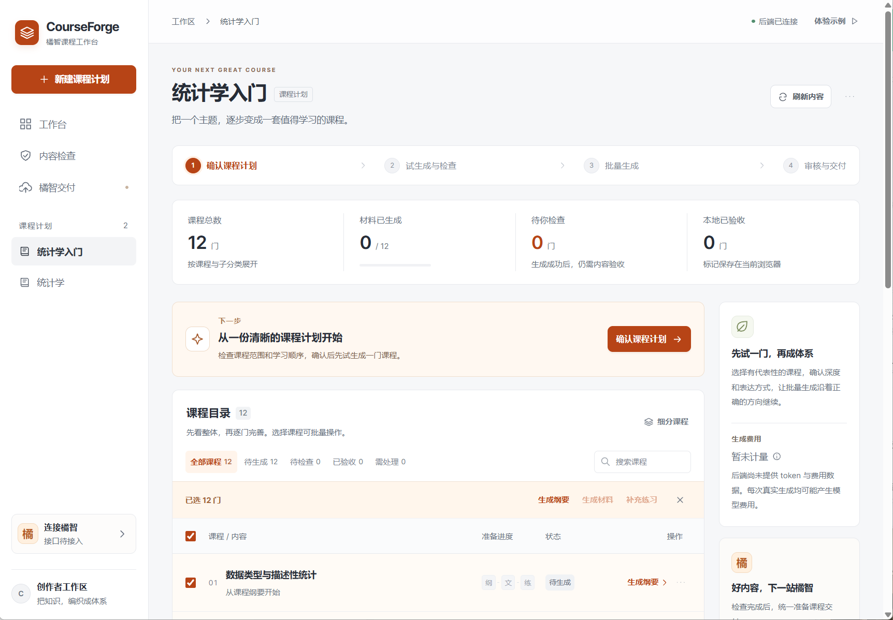
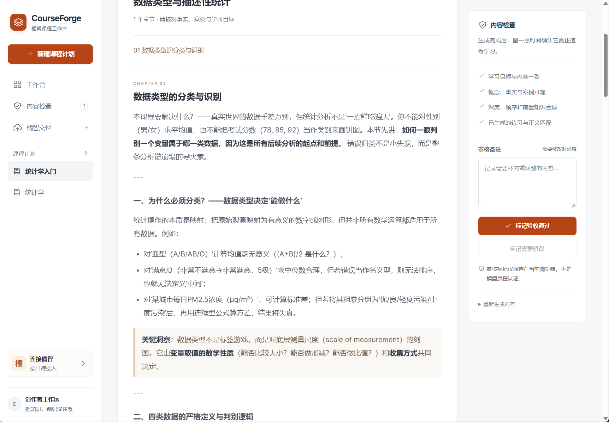
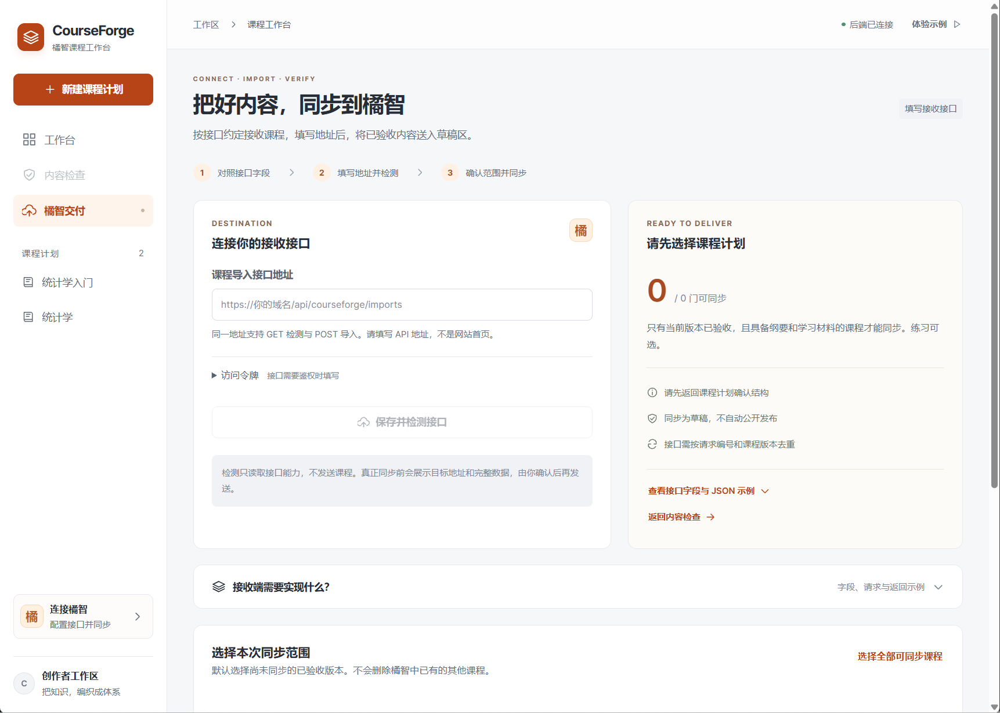

# CourseForge 前端

[前端仓库](https://github.com/Noahwakuwaku/courseforge-frontend) · [后端仓库](https://github.com/Noahwakuwaku/courseforge-api)

简体中文 | [English](README.md)

CourseForge 是一个引导式课程内容生产工作台，最初用于为个人创作平台「橘智」完善内容板块。它将课程规划、样本检查、批量生成与人工验收组织为一条清晰流程。

本仓库是 Vue 前端，需要配套的 FastAPI 服务才能生成和持久化内容。

无需后端体验：启动前端后打开 `http://localhost:5173/?demo=1`。示例模式有明确提示，仅使用本地数据与模拟生成，不请求业务 API、不产生模型费用，也不允许向外部同步。真实工作区支持配置符合协议的橘智导入接口。

## 界面预览

### 课程计划与批量生成



### 内容阅读与人工审核



### 可配置的橘智交付



截图展示不同操作时点。前两张侧栏保留早期接入文案，交付页展示当前配置界面，不代表已经同步成功。[查看全部 6 张界面与产品设计说明](docs/PRODUCT_DESIGN.zh-CN.md)。

## 功能

- 根据名称创建单个或多个学科
- 浏览学科、课程及子分类
- 单独或批量生成课程纲要、学习材料和考试题
- 在页面切换时继续跟踪耗时较长的后台生成任务
- 重新生成纲要、材料和题目
- 以章节形式阅读生成的学习材料
- 完成单选或多选题，并查看分数与解析
- 通过下一步主动作完成计划确认、样本检查与批量生产
- 搜索、筛选和选择课程；保留任务结果，只重试失败项
- 安全 Markdown 阅读、审核备注，以及内容变化后的复核提醒
- 查看接收接口字段与 JSON 示例，填写地址并检测协议，确认后同步已验收课程至草稿
- 按课程核对同步回执；未知结果保留原请求，刷新后可原样重试；短期令牌只存页面内存
- 响应式布局、键盘弹层操作、与真实环境隔离的示例模式

## 技术栈

- Vue 3（Composition API）
- Pinia
- Vite 5
- 浏览器原生 Fetch API

## 环境要求

- Node.js 18 或更高版本
- npm 9 或更高版本
- 已运行的 CourseForge API、MongoDB、Redis 和 ARQ Worker

## 快速开始

```bash
git clone https://github.com/Noahwakuwaku/courseforge-frontend.git
cd courseforge-frontend
npm install
```

复制环境变量示例，并按需修改后端地址：

```bash
cp .env.example .env
```

Windows PowerShell 请使用 `Copy-Item .env.example .env`。

启动开发服务器：

```bash
npm run dev
```

打开 <http://localhost:5173>。默认 `/api` 请求由 Vite 开发代理转发至 `http://localhost:8000`。已有 `.env` 不会自动改写。

## 环境变量

| 变量 | 默认值 | 说明 |
| --- | --- | --- |
| `VITE_API_URL` | `/api` | 开发环境使用 Vite 代理；生产环境需配置同域反向代理或指定完整 API 地址 |

所有以 `VITE_` 开头的变量都会被写入浏览器构建产物，请勿在其中存放 API Key 或其他秘密信息。

## 常用命令

```bash
npm run dev      # 启动本地开发服务器
npm run build    # 在 dist/ 中生成生产构建
npm run preview  # 本地预览生产构建
npm test         # 运行 Node 内置测试工具执行单元与回归测试
```

## 项目结构

```text
src/
├── api/
│   └── index.js        # HTTP 请求与任务轮询
├── stores/
│   ├── course.js       # 课程数据和生成状态
│   └── delivery.js     # 接口连接、同步回执与未知结果恢复
├── components/         # 阅读、审核、交付配置、原生弹层和图标
├── composables/        # 浏览器本地审核存储
├── data/               # 隔离的示例内容
├── styles/             # 工作台视觉样式与响应式布局
├── utils/              # 安全 Markdown、内容版本、叶子课程与同步协议
├── App.vue             # 工作区导航与引导流程
└── main.js             # Vue 与 Pinia 入口
```

产品文档：[PRD 与开发范围](docs/PRD.zh-CN.md) · [产品设计案例：问题、取舍、界面、结果](docs/PRODUCT_DESIGN.zh-CN.md) · [橘智接收接口字段与协议](docs/JUZHI_SYNC_API.zh-CN.md)。

可选浏览器回归脚本为 `tests/browser-smoke.mjs`，需本机 Chrome 及 Node 可找到的 Playwright；也可用 `PLAYWRIGHT_MODULE_PATH` 指定其模块路径。运行 `node tests/browser-smoke.mjs` 会在 5174 端口启动临时 Vite 服务，拦截全部业务 API，不产生模型费用。设置 `BROWSER_CHANNEL=msedge` 可改用 Edge；`SCREENSHOT_DIR` 可指定已有的截图保存目录。

`node tests/delivery-browser.mjs` 使用相同浏览器环境，额外启动独立本机接收接口，验证真实 CORS、鉴权、部分失败、刷新后原样重试和窄屏布局，不连接真实橘智。两个脚本共用 5174 端口，请顺序运行。

## 配置橘智同步

1. 橘智按 [接收接口协议](docs/JUZHI_SYNC_API.zh-CN.md) 实现同一地址的 GET 检测与 POST 草稿导入，配置鉴权、CORS 与幂等去重。
2. 在「橘智交付」填写完整 HTTPS API 地址；如需鉴权，填写短期导入 Token，再点击「保存并检测接口」。普通网站首页不能作为导入接口。
3. 确认课程结构，验收当前内容，选择课程并核对发送预览，然后同步到草稿区。
4. 核对逐门返回的草稿 ID。明确失败可只重试未成功项；结果未知时保留原请求编号并使用原请求重试。

同步不调用模型、不自动发布。Token 不持久保存，刷新后需重填；未确认请求的完整内容会暂存在本浏览器，最终结果确认后只保留回执。清除浏览器数据或更换设备前须核对来源映射，避免重复导入。客户端已实现，正式橘智接收服务仍需部署和联调。

## 生成流程

1. 前端将学科名称提交给 API。
2. API 生成课程骨架并写入 MongoDB。
3. 展开课程、生成纲要、材料和考试的任务被提交到 Redis。
4. ARQ Worker 调用大模型并保存结果。
5. 前端批量轮询任务 ID，并在每项任务完成后更新界面。

纲要、学习材料与练习是独立操作，不会因生成纲要而自动生成材料。纲要完成后，页面会将下一步主动作改为生成材料。

## 生产部署提示

- 构建前设置线上 HTTPS API 地址，或为 `/api` 配置同域反向代理。开发代理不会打包进静态产物，也不适用于 `vite preview`。
- 在后端为前端域名配置严格的 CORS 白名单。
- 将 `dist/` 部署到静态托管服务或 CDN。
- 真实 `.env` 文件、凭据、本机导出文件（`output/`）、缓存、`node_modules/` 和 `dist/` 不应进入 Git。仅保留无密钥的 `.env.example`；`VITE_` 变量属于浏览器可见的公开配置。
- 生成内容属于模型输出，用于重要学习或评测前应由人工复核。

## 当前状态

本轮已加入引导式界面、本地审核、失败反馈与自动化测试。仍需注意以下边界：

- 计划确认和审核标记只存于当前浏览器，不是服务端审计记录；内容改变后需要重新复核。
- 批次与任务 ID 暂存页面内存。切换计划不影响跟踪，刷新则不会恢复轮询；后台任务可能继续执行，应先检查已保存结果，避免重复生成。
- 提交响应不明确时不自动重试。有任务 ID 可重新查询，无 ID 需先在后端核对。
- 尚未实现真实 token／费用统计、预算封顶、持久版本、生成任务的服务端幂等和工作台身份认证。
- 橘智同步客户端需配套接收端；接收端负责真实鉴权、去重、冲突检测和持久化。连接检测通过不代表已写入课程，本地回执也不是远端实时状态。
- 重新生成可能覆盖后端旧内容。需再次核对纲要、正文、练习的一致性；前端不提供版本回滚。
- Markdown 支持标题、列表、引用、强调和代码块；原始 HTML、可执行链接和嵌入内容不会被渲染。

## 参与贡献

欢迎提交 Issue 和 Pull Request。较大改动建议先通过 Issue 讨论预期行为。请勿提交生成文件或凭据，并在提交前运行 `npm run build`。

## 许可证

本项目采用 MIT License，详情请参阅 [LICENSE](LICENSE)。

