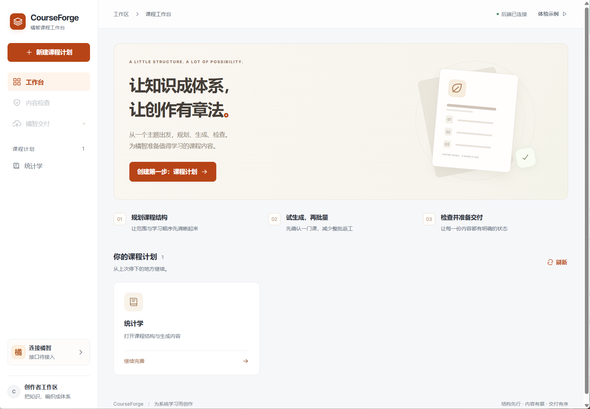
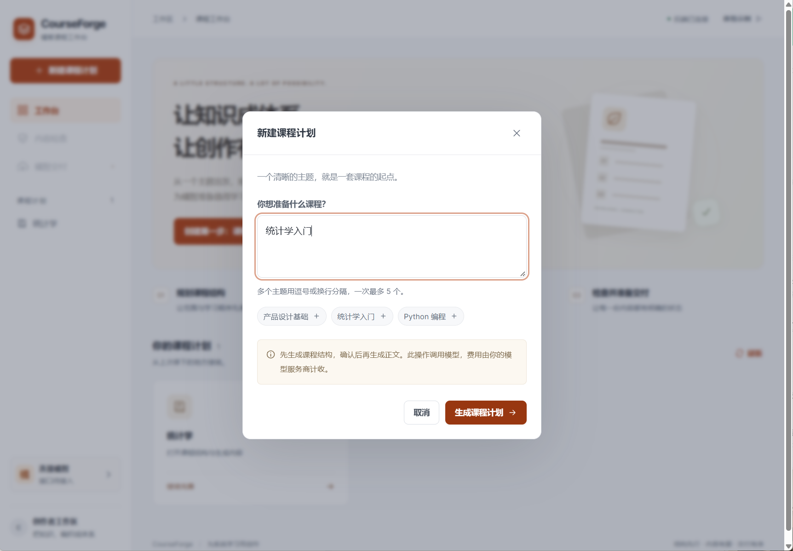
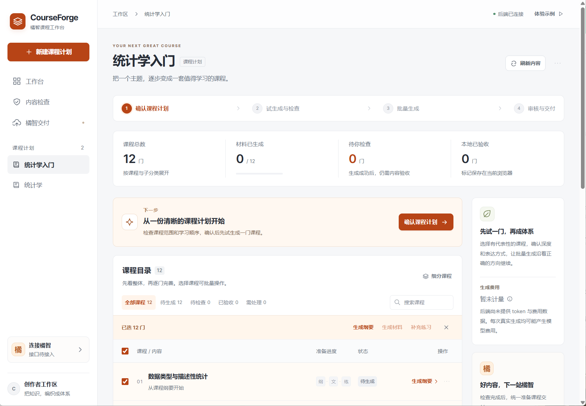
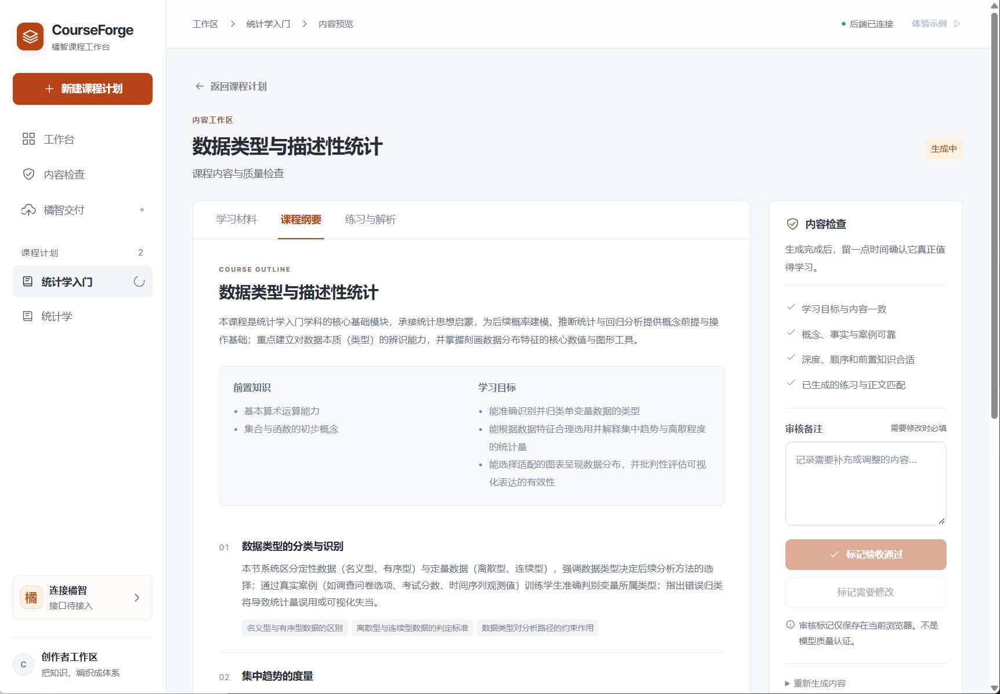
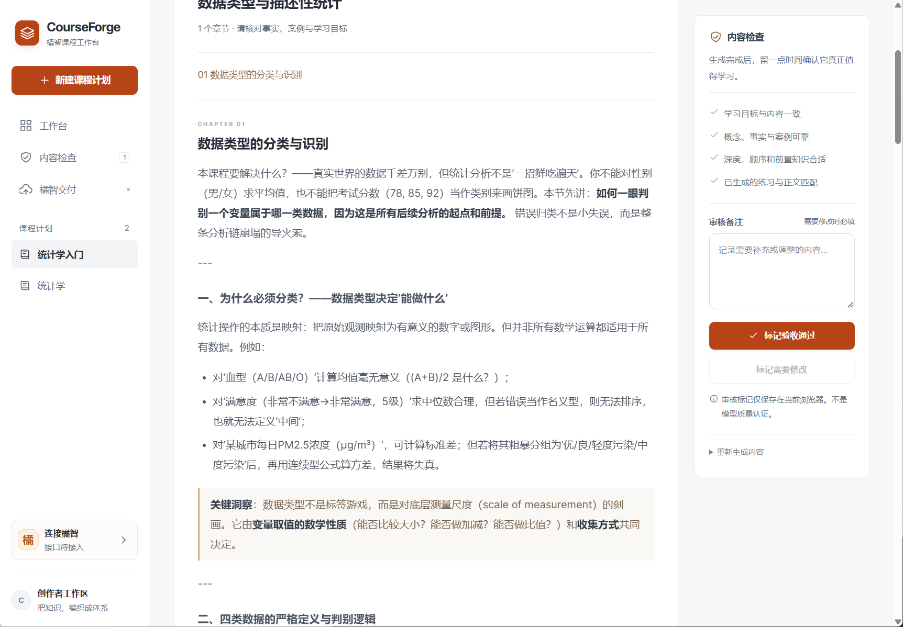
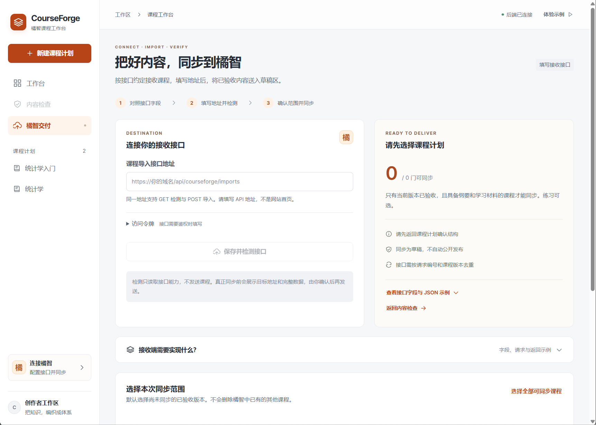

# CourseForge 产品设计案例

CourseForge 是为个人创作平台「橘智」开发的 AI 课程内容生产工作台。

## 问题

需要批量、快速地生成大量可用的系统性课程内容，为平台补充内容供给。

可用课程的最低标准是：有明确学习目标和前置知识，课程顺序合理，正文覆盖纲要，关键事实经过人工核对，已生成练习与正文一致。逐门操作耗费人工时间，直接全量生成又可能放大质量问题，增加模型费用与返工。

## 取舍

在人工时间、成本与质量之间，采用“先验证样本，再批量生成，最后人工验收”的方案。

- 人工时间：将重复生成交给批量操作，人工集中在结构确认、样本判断和最终验收；保留必要审核，不追求完全无人干预。
- 成本：先用一门样本验证方向，默认跳过已有内容，只重试失败项；接受前期多一次判断，以降低无效生成和整批返工的风险。
- 质量：检查课程目标、事实、深度和前后衔接，内容变化后重新审核；接受一定审核时间，不把“生成成功”直接视为“可用”。

## 界面

设计目标是让用户看到页面就知道下一步，减少记忆和学习成本。

- 流程引导：按“课程计划 → 样本检查 → 批量生成 → 审核交付”组织页面，突出当前最重要的动作。
- 按需操作：选中课程才显示批量工具，重生成等低频操作收起；执行前展示范围，执行后保留逐项结果。
- 阅读与判断：正文与审核区相邻，清楚区分生成中、待检查、已验收和需要修改。
- 视觉与人体工学：以橘色强调主动作，保持清晰分组、舒适字号和留白，适配窄屏及键盘操作。

## 产出

- 可运行的课程工作台，支持课程规划、纲要与材料批量生成、可选练习、内容阅读和人工审核。
- 可配置的橘智同步页面，展示接口字段、支持发送确认与逐项回执；橘智接收端仍需按协议接入。
- 隔离示例模式、响应式界面和自动化回归测试，支持产品演示与后续迭代。

后续以已验收课程数、人工耗时和模型费用评估使用效果。
## 界面示例

以下截图按操作流程排列，保留不同操作时点的真实状态；图号与 PRD 中的需求对照表对应。

### 01 工作台

以创建课程计划为主要入口，说明规划、试生成和检查的基本顺序，已有计划可以继续处理。

图 01 至图 05 的侧栏保留早期接入文案；当前交付配置界面见图 06。

### 02 创建课程计划

输入主题即可开始，示例降低填写成本；生成前明确多主题数量限制、先生成结构及模型费用提示。

### 03 课程计划与批量操作

阶段指引、准备进度与下一步动作集中展示。选中课程后出现批量工具，并按纲要、材料、练习的依赖关系提供操作。

截图为目录已生成、材料尚未生成的状态。

### 04 纲要与学习目标

纲要集中呈现课程定位、前置知识、学习目标和章节，便于判断结构与覆盖范围；审核入口与阅读区相邻。

截图时任务仍在生成，审核按钮不可用；当前版本已将生成状态细分为纲要、材料和练习。

### 05 材料阅读与人工审核

正文按章节阅读，右侧保留内容检查清单、修改备注与验收动作，支持在阅读时作出质量判断。

截图为正文滚动阅读状态，展示审核入口，不代表该课程已验收通过。

### 06 配置接口与交付

按查看字段、填写地址、确认范围组织交付操作。接口检测与课程发送分开，只有满足条件的课程才能同步为草稿。

截图为尚未选择计划、尚未配置接口的状态，不是同步成功回执。
